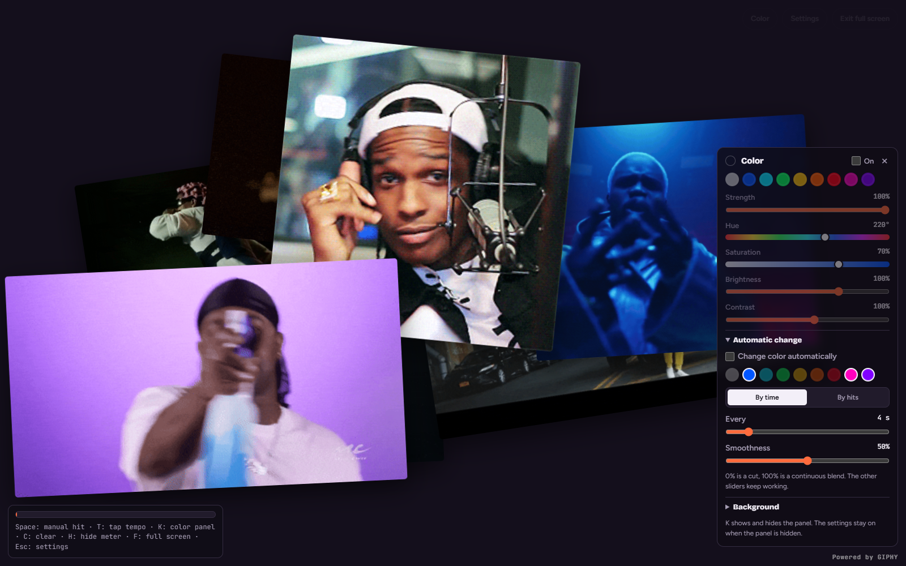

# GIFbit

Prosta aplikacja do wizualizacji muzyki: mikrofon wykrywa uderzenia, a na ekranie pojawiają się animacje z GIPHY. Można też sterować pokazem ręcznie, bez mikrofonu. Aplikacja działa w przeglądarce, bez backendu, frameworka i procesu budowania.

