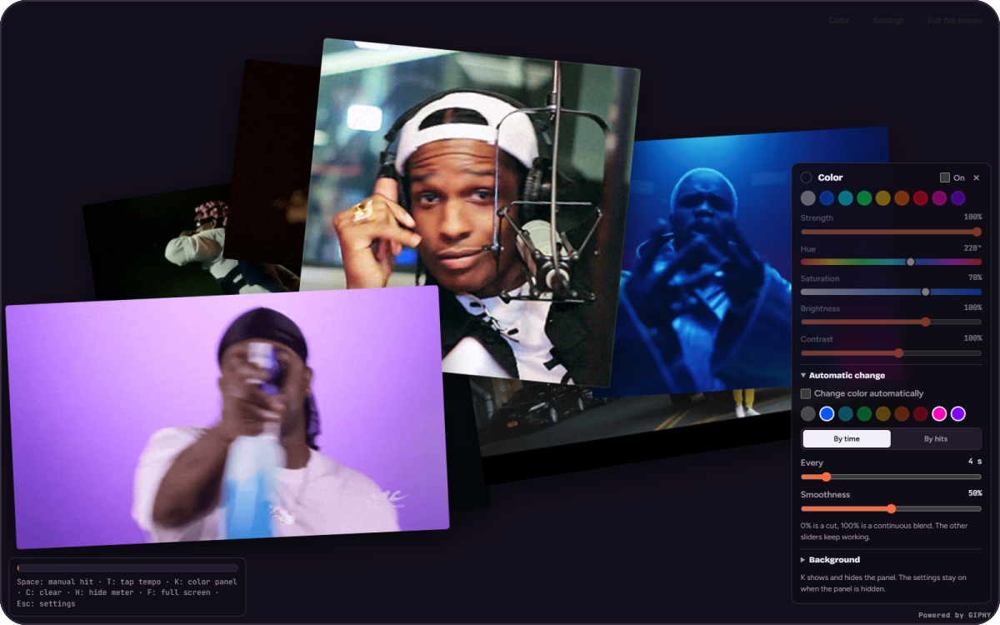
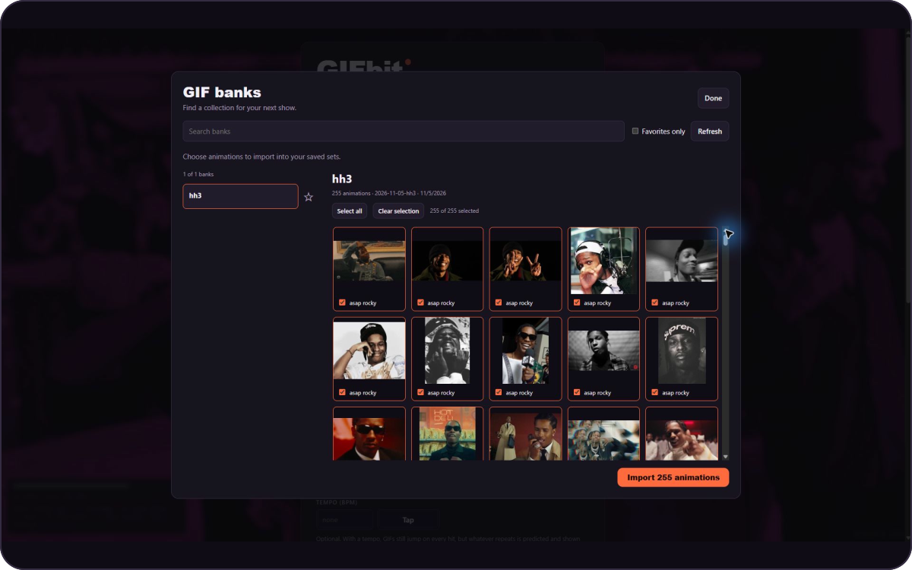
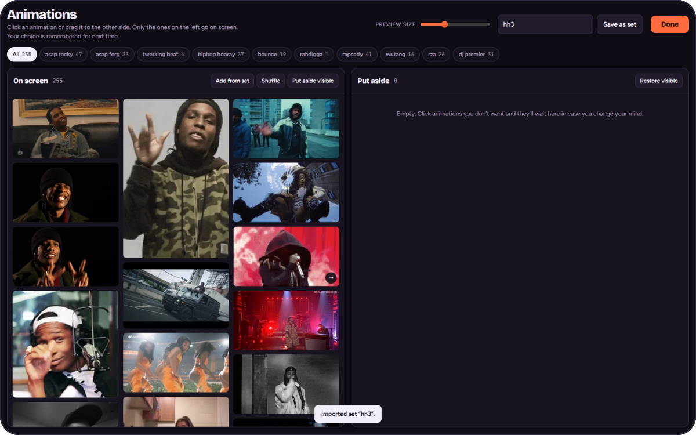
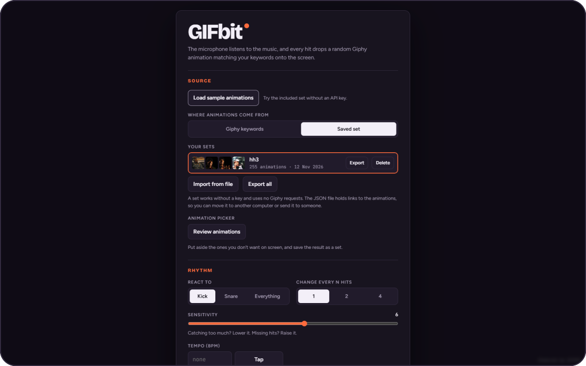

<div align="center">


# GIFbit

**Animations that land on the beat.**<br>
Pick your GIFs, play some music, and turn your screen into a beat-driven show.


[](#github-pages)

**[Contribute](#contributing-gif-banks)** ·
**[Quick start](#quick-start)** ·
**[Features](#features)** ·
**[GIF banks](#gif-banks)** ·
**[Single HTML](#single-html-file)** ·
**[GitHub Pages](#github-pages)** ·
**[Documentation](#project-structure)**

<br>

<a href="https://i.imgur.com/OJO2YLg.png"></a>

</div>

## Why GIFbit

GIFbit is inspired by [See Hear Party (2014)](https://experiments.withgoogle.com/see-hear-party), Peter Javidpour's GIF-based music visualizer.

A simple music visualizer: the microphone detects beats and GIPHY animations appear on screen. You can also control the show manually, without a microphone. The app runs in your browser with no backend or framework. A small build step prepares a static `dist/` directory for publishing; you can run the source directly without building it.

## Contributing GIF banks

Share a curated bank through a pull request to **[gif-banks/](gif-banks/)**. You do not need to change the application code or maintain an index.

<p align="center">
<a href="https://i.imgur.com/HfZ1X0z.jpeg"></a>
<br><sub><b>Bank preview</b> — open a community bank, preview its animations, and import your selection.</sub>
</p>

### Bank requirements

- Use JSON exported by GIFbit, with `gifbit: 1` and a nonempty list of animations. Each animation must have a unique ID within its set and a valid HTTPS image URL. Submit the JSON links, not the GIF image files.
- Give the bank a descriptive **Name** (up to 60 characters) and, when useful, a **Description** (up to 1000 characters) explaining its theme. Older banks without these fields remain supported: the app uses the filename and an empty description.
- Keep the filename format **`YYYY-MM-DD-bank-name.json`**, for example `2026-11-12-neon-city.json`. Use the export date in UTC, lowercase ASCII letters, digits, and hyphens. The date must be valid.
- Add a new file for a new bank. If that filename already exists, choose another name; only replace an existing file when your PR intentionally updates that bank.
- Preview the animations before submitting. Keep a bank-only PR limited to JSON files in `gif-banks/`; generated builds and dependencies do not belong in the PR.

### Submit a bank

1. In the [app](https://peterporzuczek.github.io/gifbit/), choose your animations in **Review animations** and use **Save as set**.
2. Open the saved set in Settings, click **Export**, fill in **Name** and **Description**, and download the JSON file.
3. Fork this repository, create a branch, and add the exported file to **`gif-banks/`**.
4. From the repository directory, validate the bank with Node.js 20 or newer; no package installation is needed:

   ```sh
   npm run check:banks
   ```

5. Commit the file and open a pull request against **`PeterPorzuczek/gifbit:main`**. Briefly describe the bank's theme and whether it adds a new bank or updates an existing one. The **Validate GIF banks** check must pass; fix any reported filename, metadata, or animation errors.

After the PR is merged, click **Refresh** in **Browse GIF banks** to see the bank. Its contents are downloaded when opened, and its name and description are then remembered in the list.

## From music to a show

After [starting the app](#quick-start), follow these four steps:

1. Click **Browse GIF banks**, open a bank, and choose **Import animations**. Import every animation or select individual GIFs. No GIPHY key is required. You can also load your own JSON file through **Saved set → Import from file**.
2. Choose **Review animations** to review and narrow down the set, or go straight to **Start without microphone**.
3. Press **Space** or click the stage to trigger a beat and display an animation.
4. Choose **Start** and allow microphone access to make the show react to music from your speakers. Microphone access requires HTTPS or localhost.

## Features

<table>
<tr>
<td width="50%" valign="top">

### GIPHY animations

Search using up to **10 words or phrases**, separated by commas, semicolons, or line breaks. Duplicate phrases are ignored. Choose GIFs, stickers with transparent backgrounds, or both. The PG-13 content filter can be turned off.

Enter your own GIPHY key in Settings. Limits depend on your API plan; each search makes one request per phrase and animation type. Displaying loaded results does not make additional search requests.

### Your own sets

In **Review animations**, click or drag animations between **On screen** and **Put aside**. Filter by phrase, resize thumbnails, and move all visible items at once. **Shuffle** changes the list order, while **Add from set** merges another saved set or JSON file without duplicating animation IDs.

**Save as set** saves the active animations; using an existing name updates that set. Import multiple files, export one set or all sets, and delete sets with a second confirmation click. The `gifbit: 1` format supports a single set, an array, or an object containing a `sets` array.

The example bank **gif-banks/2026-11-05-hh3.json** contains the original 255 sample animations, unchanged. Sets contain HTTPS image links, so playback requires an internet connection.

### Community banks

Browse banks published in the repository, search by name and description, and star your favorite **whole banks**. Opening a bank shows its description and animated thumbnails. Import the entire bank or selected GIFs into your saved sets.

Export opens a form with **Name** and **Description** fields. These details are saved in the JSON file, and the filename includes a date, such as `2026-11-12-neon-city.json`.

### Controls during a show

**Space or a click on the stage** triggers a manual beat, even without a microphone. Keyboard shortcuts open Settings, the color panel, the meter, and full screen, and let you tap the tempo or clear the stage.

Controls hide automatically. The app uses a screen wake lock when the browser supports it. Settings, saved sets, and excluded animations are stored locally for your next session.

</td>
<td width="50%" valign="top">

### Rhythm and microphone

Choose **Kick** (30–150 Hz), **Snare** (200–6000 Hz), or **Everything** (30–16000 Hz), sensitivity from 1–10, and an animation change every 1, 2, or 4 beats.

Without a BPM setting, the app reacts to detected hits. With an optional tempo of **50–220 BPM**, it aligns a beat grid and predicts repeating patterns while continuing to respond to new hits and transitions. Enter the tempo or use **Tap**: it is calculated after four taps, and a longer pause starts a new measurement.

Limit GIF changes to **1/32, 1/16, 1/8, or 1/4 notes**; faster hits still make the image bounce. **Calibrate** adjusts visual lead time from **0–250 ms**. The meter shows the signal level, detection threshold, and synchronization and prediction status.

Detection runs in an `AudioWorklet`, with a `ScriptProcessor` fallback. Audio is analyzed locally, without recording or uploading it. Leaving the page releases the microphone.

### A full-screen stage

Display a **collage of 1–12 animations** or one animation at a time across the screen. Choose random playback or **In order** to follow the list. Images are preloaded and decoded; slower downloads do not change the sequence in ordered playback.

Set a background color or use your own image, including a GIF, with **0–80%** dimming. Bounce strength from **0–10** controls how much the image reacts to beats. The system's reduced-motion preference disables bouncing.

### Live colors

The color panel stays available during a show: presets, hue, saturation, strength, brightness, contrast, and optional background tinting. Hiding the panel does not turn off the effect.

Cycle automatically through a selected palette every **0.5–30 seconds** or every **1, 2, 4, 8, or 16 beats**. Smoothness at **0%** produces a cut; **100%** produces a continuous transition. When BPM is set, colors follow the tempo and beat grid.

</td>
</tr>
</table>

<table>
<tr>
<td width="50%" align="center" valign="top">
<a href="https://i.imgur.com/xfoCQh5.png"></a>
<br><sub><b>Animation picker</b> — choose what appears on screen and save your own set.</sub>
</td>
<td width="50%" align="center" valign="top">
<a href="https://i.imgur.com/i9wk701.png"></a>
<br><sub><b>Show settings</b> — animation sources, beat response, and stage appearance.</sub>
</td>
</tr>
</table>

## Quick start

Requires Node.js 20 or newer. From the project directory, run:

```sh
npm ci
npm start
```

Open [localhost:4173/gifbit/](http://127.0.0.1:4173/gifbit/). `npm start` builds the app into `dist/` and starts a local preview. After installing dependencies once, you only need `npm start`.

For development, preview the source without building or installing dependencies:

```sh
npm run dev
```

The address stays the same. Refresh the page after editing files. The source uses native JavaScript modules and requires HTTP or HTTPS.

Run `npm run build` to prepare the publishing directory, or `npm run preview` to serve an existing build. `dist/` contains only HTML, CSS, the icon, and two JavaScript files. Styles and the icon go into `dist/assets/`, while the audio processor goes into `dist/audio/`. You can publish the entire `dist/` directory on any static host.

## GIF banks

The panel reads from **`gif-banks/` on the `main` branch of `PeterPorzuczek/gifbit`**. The app lists files through the GitHub Trees API and fetches a selected bank through the GitHub Blobs API using its SHA. JSON files are downloaded only when you click a bank. This works the same way in the source preview, production build, and single HTML export. There is no local bank index or copy of bank JSON files in `dist/`. API documentation: [repository trees](https://docs.github.com/en/rest/git/trees#get-a-tree), [file contents](https://docs.github.com/en/rest/git/blobs#get-a-blob).

The API file listing does not include metadata stored inside the files. An unopened bank therefore initially shows its filename without `.json` and an empty description. Once opened, the app uses its `name` and `description` fields when available and remembers them for your next visit. A changed file SHA invalidates the cached metadata. Missing or empty fields fall back to the filename and an empty description.

A star marks an entire bank as a favorite, and **Favorites only** filters the list. Search matches filenames as well as names and descriptions that have already been loaded. **Refresh** fetches the current list. After opening a bank, use **Select all** and **Clear selection** to choose animations to import. Import creates a saved set that you can then edit in **Review animations**.

The panel uses the public API without a token. Connection failures, GitHub rate limits, invalid JSON, and empty repositories produce a message and allow you to retry. New local files appear in the panel only after they are published on `main`. Before publishing, you can check them with **Import from file**.

To add or update a bank, follow the [contribution guide](#contributing-gif-banks) near the top of this README.

Banks use the app's export format: `gifbit: 1`, `name`, `description`, `created`, `updated`, `words`, and `items`. Older files without `description` still work. Exporting all sets produces a `sets` array; the panel treats that file as one bank and combines its animations without duplicates. Importing the file manually preserves the separate sets.

## Single HTML file

The optional export packages the app into a single file. Install development tools once, then run:

```sh
npm ci
npm run build:single
```

This creates **`dist/gifbit.html`** alongside the regular build. You can copy that file to another computer and open it in a browser. It includes the interface, styles, icon, application code, and audio processor. Manual playback and set management do not require neighboring files or a local server.

Browsing banks through the GitHub API, downloading animations, and searching require an internet connection. You can still import your own sets from JSON files. Microphone access depends on browser permissions and support for local files; if access is denied, serve the same HTML over HTTPS or localhost.

Fonts load from Google Fonts when online, including in the single HTML export. System fonts keep the interface usable if they cannot be downloaded.

The build uses esbuild and needs no network access after dependencies are installed. Every build recreates `dist/` from scratch; Git ignores the entire directory. Run `npm run build:single` again after changing the source to update the export.

## Keyboard shortcuts

| Key | Action during a show |
| --- | --- |
| Space / stage click | Trigger a manual beat |
| T | Tap the tempo |
| K | Show or hide the color panel |
| C | Clear the stage |
| H | Show or hide the meter |
| F | Toggle full screen |
| S | Open Settings |
| Esc | Open Settings or return to the show; close the picker, banks, export, or calibration |
| ← / → during calibration | Adjust visual lead time by 5 ms |

## GitHub Pages

The [pages.yml](.github/workflows/pages.yml) workflow installs dependencies, runs unit tests, builds the app, and publishes only `dist/`. All paths are relative and work under `/gifbit/`.

To configure publishing after pushing the code:

1. Open **PeterPorzuczek/gifbit** → **Settings** → **Pages**.
2. Under **Build and deployment** → **Source**, select **GitHub Actions**.
3. Open **Actions** → **Deploy to GitHub Pages** → **Run workflow**, select **main**, and start the workflow.
4. Once deployment finishes, the app is available at [peterporzuczek.github.io/gifbit/](https://peterporzuczek.github.io/gifbit/).

Subsequent updates to `main` publish changes automatically. Generated files do not need to be committed. See the [official GitHub Pages guide](https://docs.github.com/en/pages/getting-started-with-github-pages/using-custom-workflows-with-github-pages) for details.

## Project structure

Application code in **`src/`** is organized by feature. Only `index.html` and `app.js` remain at its root. Banks live separately in **`gif-banks/`**, tools in **`scripts/`**, and tests in **`tests/`**. **`dist/`** is generated automatically.

| Path | Responsibility |
| --- | --- |
| `src/index.html` | Interface and HTML entry point |
| `src/app.js` | Module creation and initialization order |
| `src/audio/` | Microphone (`microphone.js`), hit detection (`detector.js`, `worklet.js`), beat prediction (`groove.js`), tempo and beat events (`rhythm.js`), calibration (`calibration.js`) |
| `src/library/` | Loading animations from GIPHY or sets (`catalog.js`), review and selection (`curator.js`), set management (`sets.js`), import/export validation and format (`format.js`) |
| `src/banks/` | GitHub API (`api.js`), bank parsing (`format.js`), browsing panel, favorites, and import (`panel.js`) |
| `src/stage/` | Animation playback and layout (`playback.js`), colors (`colors.js`), shortcuts and buttons (`controls.js`), full screen and wake lock (`browser.js`), starting a show and returning to Settings (`session.js`) |
| `src/settings/` | Settings form (`form.js`), defaults and validation (`schema.js`) |
| `src/core/` | Shared state and settings persistence (`state.js`), interface element access (`dom.js`), resource loading (`resources.js`) |
| `src/assets/` | `style.css` and `favicon.svg`; no local font files |
| `gif-banks/` | JSON banks contributed through PRs; the initial `2026-11-05-hh3.json` contains 255 animations |
| `scripts/serve.mjs` | Dependency-free source or `dist/` preview |
| `scripts/build.mjs` | Build into `dist/` and optional single HTML export |
| `scripts/check-banks.mjs` | Bank filename and format validation |
| `tests/` | Audio engine, data, export, and browser behavior tests |
| `.github/workflows/pages.yml` | Automatic build and deployment to GitHub Pages |
| `.github/workflows/banks.yml` | Bank validation in PRs |
| `dist/` | Ready-to-publish app; generated files ignored by Git |

Modules use native ES imports. Add new features to the relevant directory and initialize them in `src/app.js`. Code shared across features belongs in `core/`.

Banks are fetched exclusively through the GitHub API; the local server does not serve `gif-banks/`, and the build does not copy it. README previews in `.github/readme/` have matching aspect ratios and rounded SVG frames. Clicking a preview opens the original on Imgur. The project does not store font files.

## Testing

Install development dependencies, run the data, audio, and export tests, then run the browser tests:

```sh
npm ci
npm test
npx playwright install chromium
npm run test:browser
```

On Windows, you can use an existing Edge installation without downloading Chromium:

```powershell
$env:PLAYWRIGHT_CHANNEL = 'msedge'
npm run test:browser
```

Browser tests first build the app, then check it under the `/gifbit/` prefix in three forms: directly from source, as the production `dist/`, and as a single HTML file. A separate test copies only the generated HTML into an empty directory and checks bank import, playback, and the audio processor through `file://`. Bank tests use controlled GitHub API responses to check downloads on demand, metadata, favorites, selective GIF import, dated exports, changed files, delayed responses, and API errors. Other tests cover selection and dragging, saving and deleting sets, image order, rendering, colors, shortcuts, mobile layout, malformed data, GIPHY requests, microphone denial, `AudioWorklet`, the fallback detector, and stream cleanup. Test audio comes from a synthetic device; calibrate a real microphone and display on the target hardware.

## Data and assets

Settings, the API key, saved sets, and excluded animations are stored in this browser's `localStorage` (`gifbit.v1`, `gifbit.sets`, `gifbit.excluded`). Favorite banks use `gifbit.banks.favorites`, and cached names and descriptions use `gifbit.banks.metadata`. Older set formats remain compatible. The GIPHY key is not encrypted. A different app address, browser, or cleared site data means a separate storage area; export your sets to JSON beforehand if you want to keep them.

Animations are fetched directly from GIPHY and belong to their creators. Availability depends on the original image links. The interface loads Bricolage Grotesque, Figtree, and JetBrains Mono from Google Fonts, with system fallbacks while loading or offline. Font files are not stored in the repository or build output. Original screenshots are hosted on Imgur; the SVG frames are used only for README presentation.
