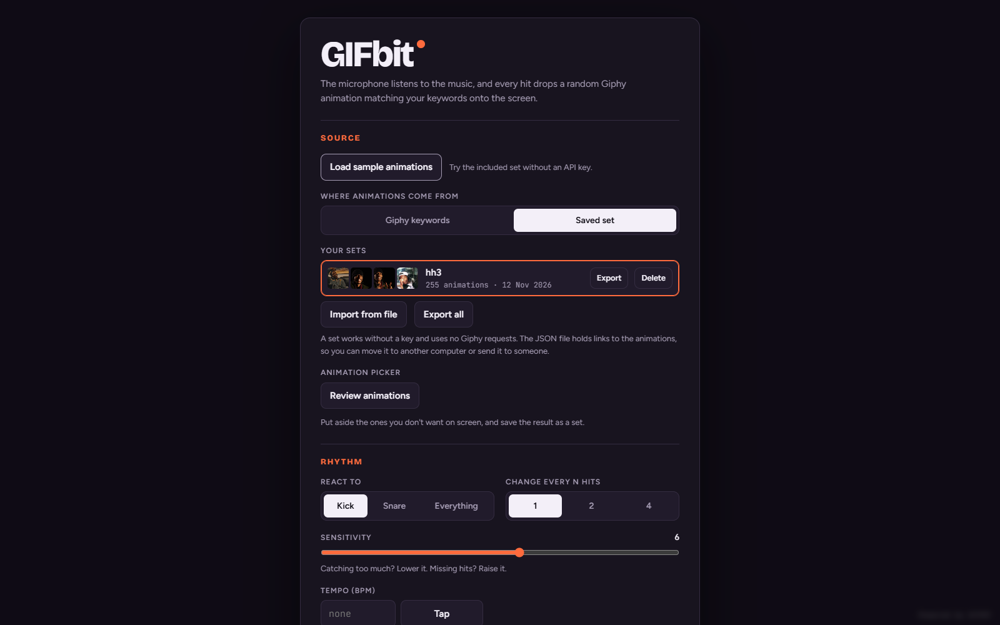
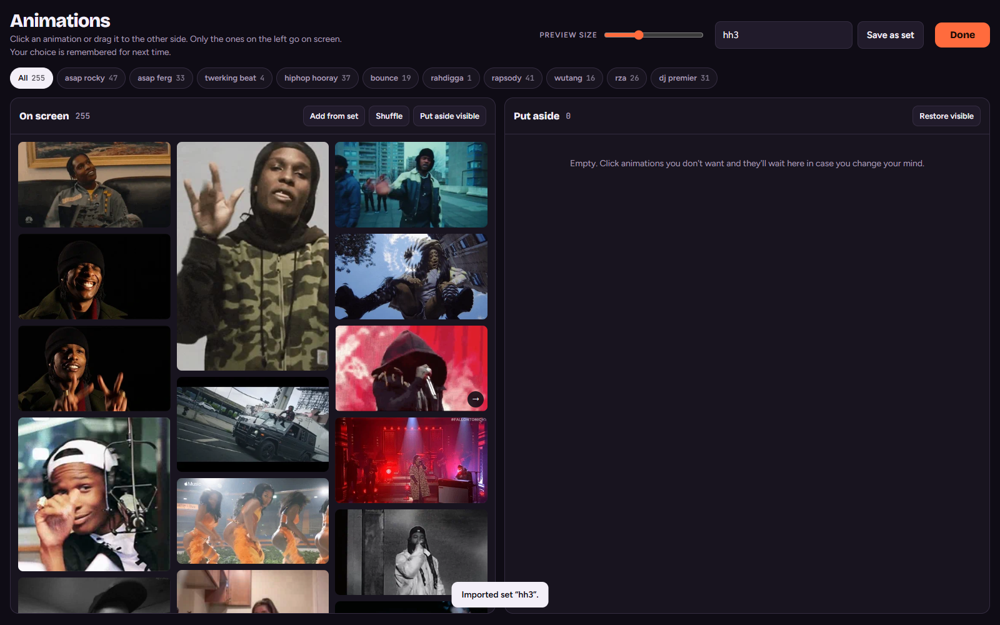

# GIFbit

Prosta aplikacja do wizualizacji muzyki: mikrofon wykrywa uderzenia, a na ekranie pojawiają się animacje z GIPHY. Można też sterować pokazem ręcznie, bez mikrofonu. Aplikacja działa w przeglądarce, bez backendu, frameworka i procesu budowania.

## Szybki start

W katalogu projektu uruchom jeden z poniższych serwerów:

```sh
node scripts/serve.mjs
```

Otwórz [localhost:4173/gifbit/](http://127.0.0.1:4173/gifbit/). Wystarczy Node.js 20 lub nowszy. Nie trzeba wykonywać `npm install`. Skrót `npm start` uruchamia ten sam serwer.

Alternatywnie, z Pythonem:

```sh
python -m http.server 4173 --bind 127.0.0.1
```

Wtedy otwórz [localhost:4173](http://localhost:4173). Aplikację należy udostępniać przez HTTP lub HTTPS, ponieważ używa natywnych modułów JavaScript. Otwarcie `index.html` przez `file://` nie wystarczy.

1. Kliknij **Load sample animations**, aby wczytać 255 animacji z dołączonego `sample.json`. Nie potrzebujesz klucza API.
2. Wybierz **Review animations**, aby przejrzeć i ograniczyć zestaw, albo od razu **Start without microphone**.
3. Naciśnij **Spację** lub kliknij scenę, aby wywołać uderzenie i wyświetlić animację.
4. Wybierz **Start** i zezwól na mikrofon, aby pokaz reagował na muzykę z głośników. Dostęp do mikrofonu wymaga HTTPS lub localhost.



## Źródła i zestawy animacji

- Wyszukiwanie GIPHY według maksymalnie 10 słów lub fraz. Separatory: przecinki, średniki i nowe linie. Powtórzone frazy są pomijane.
- GIF-y, naklejki z przezroczystym tłem albo oba typy jednocześnie. Filtr treści PG-13 można wyłączyć.
- Własny klucz GIPHY jest wpisywany w ustawieniach. Limity zapytań zależą od planu API; wyszukiwanie używa jednego zapytania na frazę i typ animacji. Wyświetlanie już wczytanych wyników nie wykonuje kolejnych zapytań wyszukiwania.
- **Review animations** pokazuje kolumny **On screen** i **Put aside**. Kliknięcie albo przeciągnięcie przenosi animację między kolumnami. Dostępne są filtry fraz, zmiana rozmiaru miniaturek i operacje na wszystkich widocznych elementach.
- **Shuffle** zmienia kolejność listy. **Add from set** dołącza animacje z innego zapisanego zestawu albo pliku JSON, bez duplikowania identyfikatorów.
- **Save as set** zapisuje aktywne animacje. Użycie istniejącej nazwy aktualizuje zestaw. Można importować wiele plików, eksportować pojedynczy zestaw lub wszystkie zestawy i usuwać zestawy po ponownym kliknięciu potwierdzenia.
- Zachowany format `gifbit: 1`: pojedynczy obiekt zestawu, tablica zestawów albo obiekt z tablicą `sets`. Pliki zawierają linki HTTPS do obrazów, więc ich odtwarzanie nadal wymaga internetu. `sample.json` zachowano bez zmian.



## Rytm i mikrofon

- Wybór pasma: **Kick** (30–150 Hz), **Snare** (200–6000 Hz) lub **Everything** (30–16000 Hz).
- Czułość detektora 1–10; zmiana animacji co 1, 2 lub 4 uderzenia.
- Opcjonalne tempo 50–220 BPM wpisywane ręcznie lub wystukiwane przyciskiem **Tap**. Po czterech stuknięciach aplikacja wylicza tempo; dłuższa przerwa rozpoczyna pomiar od nowa.
- Bez BPM aplikacja reaguje bezpośrednio na wykryte uderzenia. Z BPM dopasowuje siatkę rytmu i przewiduje powtarzający się wzór. Nowe uderzenia i przejścia nadal obsługuje na bieżąco.
- Ograniczenie szybkości zmiany GIF-ów do 1/32, 1/16, 1/8 lub 1/4 nuty. Szybsze uderzenia nadal wprawiają obraz w ruch.
- Wyprzedzenie obrazu 0–250 ms i osobny ekran **Calibrate** do dopasowania obrazu do dźwięku na docelowym ekranie.
- Miernik poziomu sygnału, próg detekcji oraz status synchronizacji i przewidywania.
- Detekcja w `AudioWorklet`; zachowana ścieżka zapasowa `ScriptProcessor`. Dźwięk jest analizowany lokalnie, bez nagrywania i wysyłania audio na serwer. Strumień mikrofonu jest zwalniany przy opuszczeniu strony.

## Scena i kolory

- Kolaż od 1 do 12 animacji albo pojedyncza animacja na całym ekranie.
- Losowa kolejność lub odtwarzanie zgodnie z kolejnością listy. Obrazy są wstępnie ładowane i dekodowane; wolniejsze pobieranie nie zmienia kolejności w trybie **In order**.
- Kolor tła lub własny obraz, także GIF, z przyciemnieniem 0–80%.
- Siła odbicia 0–10. Systemowe ustawienie ograniczenia ruchu wyłącza odbicie.
- Panel kolorów dostępny podczas pokazu: gotowe kolory, odcień, nasycenie, siła, jasność, kontrast i opcjonalne kolorowanie tła.
- Automatyczne przechodzenie przez wybraną paletę: co 0,5–30 sekund albo co 1, 2, 4, 8 lub 16 uderzeń. Płynność 0% oznacza cięcie, 100% — ciągłe przejście. Przy ustawionym BPM kolory korzystają z tempa i siatki rytmu.
- Pełny ekran, automatycznie chowające się przyciski oraz blokada wygaszania ekranu, jeśli przeglądarka ją obsługuje.

## Skróty klawiaturowe

| Klawisz | Działanie podczas pokazu |
| --- | --- |
| Spacja / kliknięcie sceny | Ręczne uderzenie |
| T | Wystukiwanie tempa |
| K | Pokazanie lub ukrycie panelu kolorów |
| C | Wyczyszczenie sceny |
| H | Pokazanie lub ukrycie miernika |
| F | Przełączenie pełnego ekranu |
| S | Otwarcie ustawień |
| Esc | Ustawienia / powrót do pokazu; zamknięcie przeglądu lub kalibracji |
| ← / → w kalibracji | Zmiana wyprzedzenia o 5 ms |

